# Galeria de logos

> Arquivo gerado automaticamente pelo pipeline (`npm run pipeline`) — não editar à mão.

**180** instituições com logo próprio · **442** afiliadas usando o logo do seu sistema cooperativo · **446** sem logo nas fontes oficiais.

## Logos próprios

| Logo | COMPE | ISPB | Instituição | Fonte do logo |
|---|---|---|---|---|
| 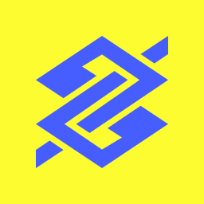 | 0001 | 00000000 | Banco do Brasil (BCO DO BRASIL S.A.) | Open Finance — BANCO DO BRASIL S.A. |
|  | 0003 | 04902979 | Banco da Amazônia (BCO DA AMAZONIA S.A.) | Open Finance — BCO DA AMAZONIA S.A. |
|  | 0004 | 07237373 | Banco do Nordeste (BCO DO NORDESTE DO BRASIL S.A.) | Open Finance — BCO DO NORDESTE DO BRASIL S.A. |
| 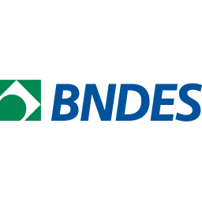 | 0007 | 33657248 | BNDES | Site oficial (revisado) |
|  | 0011 | 61809182 | UBS Corretora (UBS (BRASIL) CORRETORA DE VALORES S.A.) | Site oficial (revisado) |
| 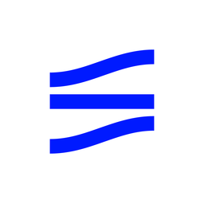 | 0014 | 09274232 | State Street (STATE STREET BR S.A. BCO COMERCIAL) | Site oficial (revisado) |
|  | 0015 | 02819125 | UBS BB Corretora (UBS BB CCTVM S.A.) | Site oficial (revisado) |
| 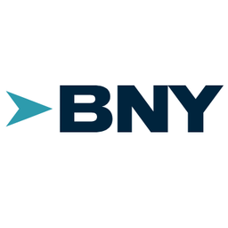 | 0017 | 42272526 | BNY Mellon (BNY MELLON BCO S.A.) | Site oficial (revisado) |
| 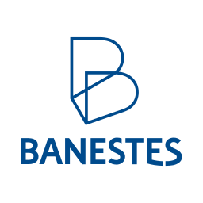 | 0021 | 28127603 | Banestes (BCO BANESTES S.A.) | Open Finance — BCO BANESTES S.A. |
| 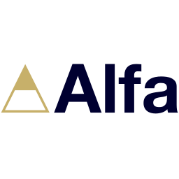 | 0025 | 03323840 | Banco Alfa (BCO ALFA S.A.) | Site oficial (revisado) |
|  | 0033 | 90400888 | Santander (BCO SANTANDER (BRASIL) S.A.) | Open Finance — BCO SANTANDER (BRASIL) S.A. |
|  | 0036 | 06271464 | Bradesco BBI (BCO BBI S.A.) | Open Finance — BANCO BRADESCO SA |
| 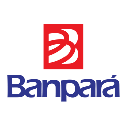 | 0037 | 04913711 | Banpará (BCO DO EST. DO PA S.A.) | Open Finance — BCO DO EST. DO PA S.A. |
| 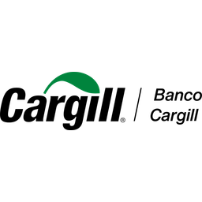 | 0040 | 03609817 | Banco Cargill (BCO CARGILL S.A.) | Site oficial (revisado) |
|  | 0041 | 92702067 | Banrisul (BCO DO ESTADO DO RS S.A.) | Open Finance — BCO DO ESTADO DO RS S.A. |
| 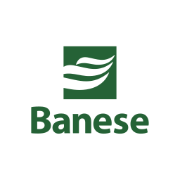 | 0047 | 13009717 | Banese (BCO DO EST. DE SE S.A.) | Open Finance — BCO DO EST. DE SE S.A. |
|  | 0063 | 04184779 | Bradescard (BANCO BRADESCARD) | Open Finance — BANCO BRADESCARD |
|  | 0064 | 04332281 | Goldman Sachs (GOLDMAN SACHS DO BRASIL BM S.A) | Site oficial (revisado) |
| 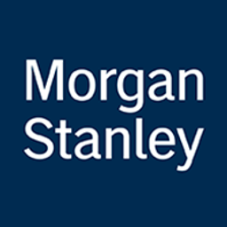 | 0066 | 02801938 | Morgan Stanley (BCO MORGAN STANLEY S.A.) | Site oficial (revisado) |
| 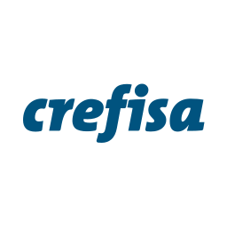 | 0069 | 61033106 | Crefisa (BCO CREFISA S.A.) | Open Finance — BCO CREFISA S.A. |
|  | 0070 | 00000208 | BRB (BRB - BCO DE BRASILIA S.A.) | Open Finance — BRB - BCO DE BRASILIA S.A. |
|  | 0074 | 03017677 | J. Safra (BCO. J.SAFRA S.A.) | Open Finance — BCO SAFRA S.A. |
|  | 0077 | 00416968 | Inter (BANCO INTER) | Open Finance — BANCO INTER |
|  | 0079 | 09516419 | PicPay Bank (PICPAY BANK - BANCO MÚLTIPLO S.A) | Open Finance — PICPAY |
| 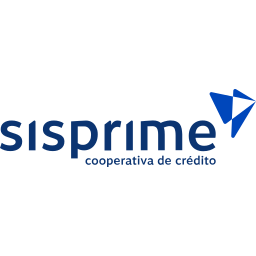 | 0084 | 02398976 | Sisprime (SISPRIME DO BRASIL - COOP) | Open Finance — SISPRIME DO BRASIL - COOPERATIVA DE CREDITO |
| 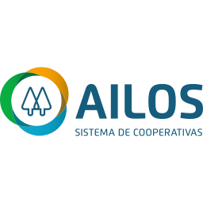 | 0085 | 05463212 | Ailos (COOPCENTRAL AILOS) | Open Finance — CENTRAL AILOS |
| 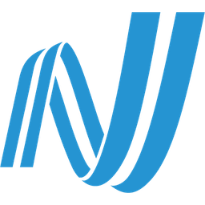 | 0100 | 00806535 | Planner (PLANNER CV S.A.) | Site oficial (revisado) |
|  | 0101 | 62287735 | Warren (WARREN RENA DTVM) | Site oficial (revisado) |
|  | 0102 | 02332886 | XP Investimentos (XP INVESTIMENTOS CCTVM S/A) | Open Finance — BANCO XP S.A. |
| 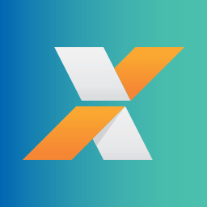 | 0104 | 00360305 | Caixa (CAIXA ECONOMICA FEDERAL) | Open Finance — CAIXA ECONOMICA FEDERAL |
| 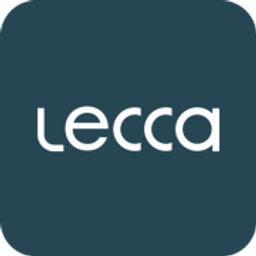 | 0105 | 07652226 | Lecca (LECCA CFI S.A.) | Site oficial (revisado) |
| 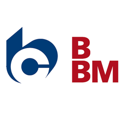 | 0107 | 15114366 | Bocom BBM (BCO BOCOM BBM S.A.) | Site oficial (revisado) |
| 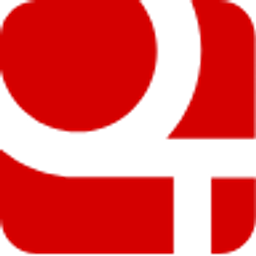 | 0111 | 36113876 | Oliveira Trust (OLIVEIRA TRUST DTVM S.A.) | Site oficial (revisado) |
|  | 0113 | 61723847 | Neon Corretora (NEON CTVM S.A.) | Open Finance — Neon Pagamentos |
|  | 0119 | 13720915 | Western Union (BCO WESTERN UNION) | Site oficial (revisado) |
|  | 0120 | 33603457 | Rodobens (BCO RODOBENS S.A.) | Site oficial (revisado) |
| 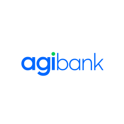 | 0121 | 10664513 | Agibank (BCO AGIBANK S.A.) | Open Finance — BCO AGIBANK S.A. |
|  | 0122 | 33147315 | Bradesco BERJ (BCO BRADESCO BERJ S.A.) | Open Finance — BANCO BRADESCO SA |
|  | 0125 | 45246410 | Genial (BANCO GENIAL) | Open Finance — BANCO GENIAL S.A. |
|  | 0129 | 18520834 | UBS BB (UBS BB BI S.A.) | Site oficial (revisado) |
| 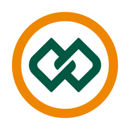 | 0133 | 10398952 | Cresol (CRESOL CONFEDERAÇÃO) | Open Finance — CRESOL CONFEDERAÇÃO |
| 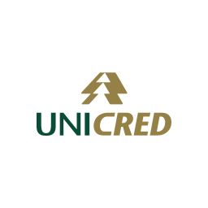 | 0136 | 00315557 | Unicred (UNICRED DO BRASIL) | Open Finance — COOPERATIVA CENTRAL DE CREDITO UNICRED DO BRASIL - UNICRED DO BRASIL |
|  | 0140 | 62169875 | Nu Investimentos (NU INVESTIMENTOS S.A. - CTVM) | Open Finance — NU PAGAMENTOS S.A. - INSTITUICAO DE PAGAMENTO |
|  | 0143 | 02992317 | Intex Bank (INTEX BANK BCO DE CÂMBIO S.A.) | Site oficial (revisado) |
|  | 0144 | 13059145 | Ebury (EBURY BCO DE CÂMBIO S.A.) | Site oficial (revisado) |
| 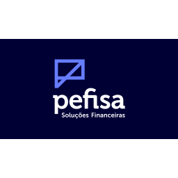 | 0174 | 43180355 | Pefisa (PEFISA S.A. - C.F.I.) | Open Finance — PEFISA S.A. - CFI |
|  | 0197 | 16501555 | Stone (STONE IP S.A.) | Open Finance — STONE PAGAMENTOS S.A. |
| 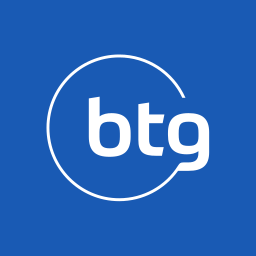 | 0208 | 30306294 | BTG Pactual (BANCO BTG PACTUAL S.A.) | Open Finance — BANCO BTG PACTUAL S.A. |
|  | 0212 | 92894922 | Banco Original | Site oficial (revisado) |
| 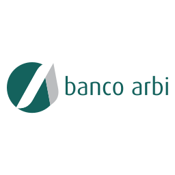 | 0213 | 54403563 | Arbi (BCO ARBI S.A.) | Open Finance — BCO ARBI S.A. |
| 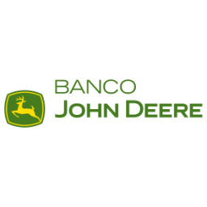 | 0217 | 91884981 | John Deere (BANCO JOHN DEERE S.A.) | Site oficial (revisado) |
| 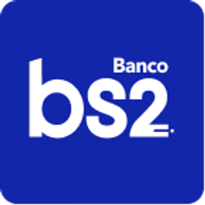 | 0218 | 71027866 | BS2 (BCO BS2 S.A.) | Site oficial (revisado) |
| 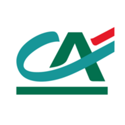 | 0222 | 75647891 | Crédit Agricole (BCO CRÉDIT AGRICOLE BR S.A.) | Site oficial (revisado) |
|  | 0224 | 58616418 | Fibra (BCO FIBRA S.A.) | Site oficial (revisado) |
|  | 0233 | 62421979 | BMG Soluções Financeiras (BANCO BMG SOLUÇÕES FINANCEIRAS S.A.) | Open Finance — BCO BMG S.A. |
|  | 0237 | 60746948 | Bradesco (BCO BRADESCO S.A.) | Open Finance — BANCO BRADESCO SA |
| 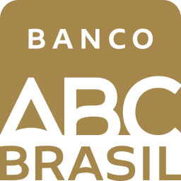 | 0246 | 28195667 | ABC Brasil (BCO ABC BRASIL S.A.) | Site oficial (revisado) |
|  | 0250 | 50585090 | BMG Consignado (BANCO BMG CONSIGNADO S.A.) | Open Finance — BCO BMG S.A. |
|  | 0254 | 14388334 | Paraná Banco (PARANA BCO S.A.) | Site oficial (revisado) |
|  | 0260 | 18236120 | Nubank (NU PAGAMENTOS - IP) | Open Finance — NU PAGAMENTOS S.A. - INSTITUICAO DE PAGAMENTO |
|  | 0265 | 33644196 | Fator (BCO FATOR S.A.) | Site oficial (revisado) |
| 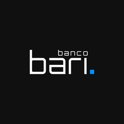 | 0268 | 14511781 | Bari (BARI CIA HIPOTECÁRIA) | Site oficial (revisado) |
| 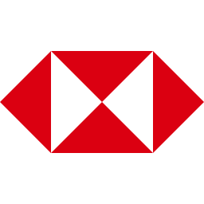 | 0269 | 53518684 | HSBC (BCO HSBC S.A.) | Site oficial (revisado) |
|  | 0274 | 11581339 | BMP (BMP SCMEPP LTDA) | Open Finance — MONEY PLUS SCMEPP LTDA |
|  | 0276 | 11970623 | Senff (BCO SENFF S.A.) | Site oficial (revisado) |
| 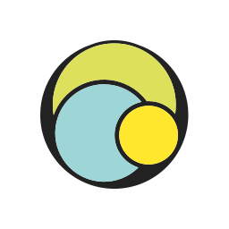 | 0290 | 08561701 | PagBank (PAGSEGURO INTERNET IP S.A.) | Open Finance — PAGSEGURO |
|  | 0292 | 28650236 | Galapagos Capital (GALAPAGOS DTVM S.A.) | Site oficial (revisado) |
| 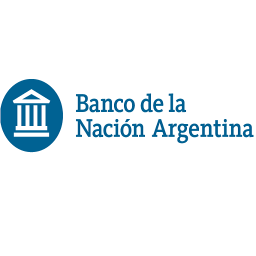 | 0300 | 33042151 | Banco de la Nación Argentina (BCO LA NACION ARGENTINA) | Open Finance — BCO LA NACION ARGENTINA |
|  | 0301 | 13370835 | Dock (DOCK IP S.A.) | Open Finance — DOCK INSTITUICAO DE PAGAMENTO S.A. |
|  | 0310 | 22610500 | Vórtx (VORTX DTVM LTDA.) | Site oficial (revisado) |
|  | 0318 | 61186680 | BMG (BCO BMG S.A.) | Open Finance — BCO BMG S.A. |
|  | 0323 | 10573521 | Mercado Pago (MERCADO PAGO IP LTDA.) | Open Finance — MERCADO PAGO INSTITUICAO DE PAGAMENTO LTDA |
| 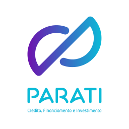 | 0326 | 03311443 | meutudo (MEUTUDO SCFI) | Open Finance — PARATI - CFI S.A. |
|  | 0329 | 32402502 | QI Tech (QI SCD S.A.) | Open Finance — QI SCD S.A. |
|  | 0330 | 00556603 | Banco Bari (BANCO BARI S.A.) | Site oficial (revisado) |
| 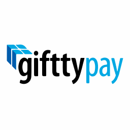 | 0332 | 13140088 | Acesso (ACESSO SOLUÇÕES DE PAGAMENTO S.A. - INSTITUIÇÃO DE PAGAMENTO) | Open Finance — ACESSO SOLUCOES PAGAMENTO SA |
| 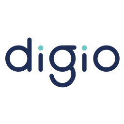 | 0335 | 27098060 | Digio (BANCO DIGIO) | Open Finance — BANCO DIGIO |
|  | 0336 | 31872495 | C6 Bank (BCO C6 S.A.) | Open Finance — BCO C6 S.A. |
|  | 0341 | 60701190 | Itaú (ITAÚ UNIBANCO S.A.) | Open Finance — ITAU UNIBANCO S.A. |
|  | 0348 | 33264668 | Banco XP (BCO XP S.A.) | Open Finance — BANCO XP S.A. |
| 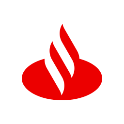 | 0352 | 29162769 | Santander Corretora (SANTANDER CTVM S.A.) | Open Finance — Santander CTVM S.A. |
| 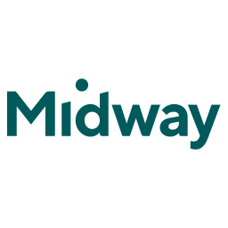 | 0358 | 09464032 | Midway (MIDWAY S.A. - SCFI) | Open Finance — MIDWAY S.A. - SCFI |
| 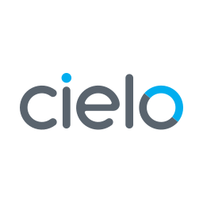 | 0362 | 01027058 | Cielo (CIELO IP S.A.) | Open Finance — CIELO S.A. |
|  | 0363 | 62285390 | QI Corretora (QI CTVM S.A.) | Open Finance — QI SCD S.A. |
|  | 0364 | 09089356 | Efí (EFÍ S.A. - IP) | Open Finance — EFI S.A. - INSTITUICAO DE PAGAMENTO |
| 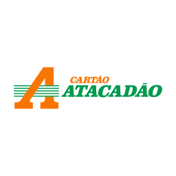 | 0368 | 08357240 | Banco Carrefour (BCO CSF S.A.) | Open Finance — BANCO CSF S/A |
|  | 0370 | 61088183 | Mizuho (BCO MIZUHO S.A.) | Site oficial (revisado) |
|  | 0374 | 27351731 | Realize (REALIZE SCFI S.A.) | Open Finance — REALIZE SOCIEDADE DE CREDITO, FINANCIAMENTO E INVESTIMENTO S.A. |
|  | 0376 | 33172537 | J.P. Morgan (BCO J.P. MORGAN S.A.) | Site oficial (revisado) |
|  | 0380 | 22896431 | PicPay | Open Finance — PICPAY |
|  | 0381 | 60814191 | Mercedes-Benz (BCO MERCEDES-BENZ S.A.) | Site oficial (revisado) |
| 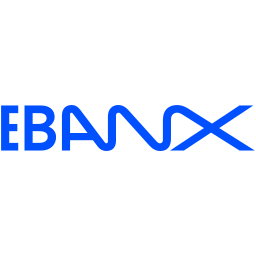 | 0383 | 21018182 | EBANX (EBANX IP LTDA.) | Open Finance — Ebanx Instituicao de Pagamento Ltda. |
|  | 0386 | 30680829 | Nu Financeira (NU FINANCEIRA S.A. CFI) | Open Finance — NU PAGAMENTOS S.A. - INSTITUICAO DE PAGAMENTO |
|  | 0389 | 17184037 | Mercantil (BCO MERCANTIL DO BRASIL S.A.) | Open Finance — BCO MERCANTIL DO BRASIL S.A. |
| 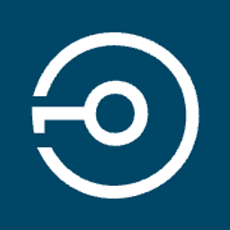 | 0393 | 59109165 | Volkswagen (BCO VOLKSWAGEN S.A) | Site oficial (revisado) |
| 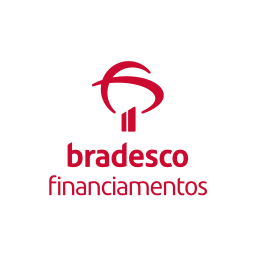 | 0394 | 07207996 | Bradesco Financiamentos (BCO BRADESCO FINANC. S.A.) | Open Finance — BCO BRADESCO FINANC. S.A. |
|  | 0396 | 13884775 | MagaluPay | Open Finance — Magalupay Instituicao de Pagamento S.A. |
|  | 0397 | 34088029 | Listo (LISTO SCD S.A.) | Open Finance — LISTO SOCIEDADE DE CREDITO DIRETO S.A. |
| 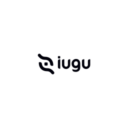 | 0401 | 15111975 | iugu (IUGU IP S.A.) | Open Finance — IUGU INSTITUICAO DE PAGAMENTO S.A. |
|  | 0403 | 37880206 | Cora (CORA SCFI) | Open Finance — CORA SCD S.A. |
|  | 0404 | 37241230 | SumUp (SUMUP SCFI S.A) | Open Finance — SUMUP SCD S.A. |
|  | 0406 | 37715993 | Accredito (ACCREDITO SCD S.A.) | Open Finance — ACCREDITO - SOCIEDADE DE CREDITO DIRETO S.A. |
|  | 0407 | 00329598 | SEFER INVESTIMENTOS DTVM LTDA - EM LIQUIDAÇÃO EXTRAJUDICIAL | Open Finance — SEFER INVESTIMENTOS DTVM LTDA |
|  | 0412 | 15173776 | Social Bank (SOCIAL BANK S/A) | Site oficial (revisado) |
|  | 0413 | 01858774 | BV (BCO BV S.A.) | Open Finance — BCO VOTORANTIM S.A. |
| 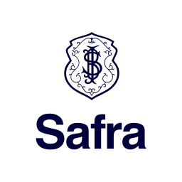 | 0422 | 58160789 | Safra (BCO SAFRA S.A.) | Open Finance — BCO SAFRA S.A. |
|  | 0426 | 11285104 | Neon Financeira (NEON FINANCEIRA - SCFI S.A.) | Open Finance — Neon Pagamentos |
|  | 0428 | 39664698 | CredSystem (CREDSYSTEM SCD S.A.) | Open Finance — CRED SYSTEM SOCIEDADE DE CREDITO DIRETO SA |
| 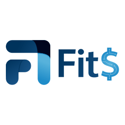 | 0450 | 13203354 | FITS IP | Open Finance — FITS INSTITUICAO DE PAGAMENTO S.A. |
|  | 0461 | 19540550 | Asaas (ASAAS IP S.A.) | Open Finance — ASAAS GESTAO FINANCEIRA INSTITUICAO DE PAGAMENTO S.A. |
|  | 0469 | 07138049 | PicPay Invest | Open Finance — PICPAY |
| 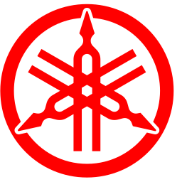 | 0475 | 10371492 | Yamaha (BCO YAMAHA MOTOR S.A.) | Site oficial (revisado) |
|  | 0477 | 33042953 | Citibank (CITIBANK N.A.) | Open Finance — BCO CITIBANK S.A. |
|  | 0479 | 60394079 | ItaúBank (BCO ITAUBANK S.A.) | Open Finance — ITAU UNIBANCO S.A. |
| 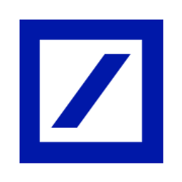 | 0487 | 62331228 | Deutsche Bank (DEUTSCHE BANK S.A.BCO ALEMAO) | Site oficial (revisado) |
|  | 0488 | 46518205 | JPMorgan Chase (JPMORGAN CHASE BANK) | Site oficial (revisado) |
|  | 0505 | 32062580 | UBS (BCO UBS BRASIL) | Site oficial (revisado) |
| 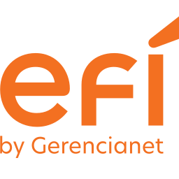 | 0507 | 37229413 | Efí Financeira (SCFI EFÍ S.A.) | Open Finance — EFI S.A. - INSTITUICAO DE PAGAMENTO |
|  | 0509 | 13935893 | Celcoin (CELCOIN IP S.A.) | Open Finance — CELCOIN INSTITUICAO DE PAGAMENTO S.A. |
| 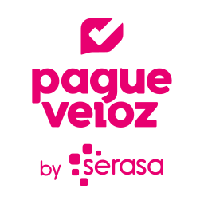 | 0517 | 03816413 | PagueVeloz (PAGUEVELOZ IP LTDA.) | Open Finance — PAGUEVELOZ INSTITUICAO DE PAGAMENTO LTDA |
|  | 0518 | 37679449 | Mercado Crédito (MERCADO CRÉDITO SCFI S.A.) | Open Finance — MERCADO PAGO INSTITUICAO DE PAGAMENTO LTDA |
|  | 0529 | 17079937 | PinBank (PINBANK IP) | Site oficial (revisado) |
| 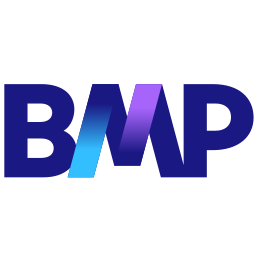 | 0531 | 34337707 | BMP (BMP SCD S.A.) | Open Finance — MONEY PLUS SCMEPP LTDA |
|  | 0534 | 00714671 | Ewally (EWALLY IP S.A.) | Site oficial (revisado) |
|  | 0536 | 20855875 | Neon (NEON PAGAMENTOS S.A. IP) | Open Finance — Neon Pagamentos |
|  | 0541 | 00954288 | FGC (FDO GARANTIDOR CRÉDITOS) | Site oficial (revisado) |
|  | 0542 | 18189547 | InfinitePay (CLOUDWALK IP LTDA) | Open Finance — CLOUDWALK INSTITUICAO DE PAGAMENTO E SERVICOS LTDA |
|  | 0554 | 28811341 | StoneX (BCO STONEX S.A.) | Site oficial (revisado) |
|  | 0555 | 02682287 | Pan Financeira (PAN FINAN) | Open Finance — BANCO PAN |
|  | 0565 | 74014747 | Ágora (ÁGORA CTVM S.A.) | Open Finance — AGORA CTVM S.A. |
|  | 0567 | 33040601 | Mercantil Financeira | Open Finance — BCO MERCANTIL DO BRASIL S.A. |
|  | 0576 | 11351086 | Mercado Bitcoin (MERCADO BITCOIN IP LTDA) | Open Finance — MERCADO BITCOIN INSTITUICAO DE PAGAMENTO LTDA |
|  | 0588 | 20308187 | Avancard (AVANCARD PROVER IP LTDA) | Open Finance — PROVER PROMOCAO DE VENDAS INSTITUICAO DE PAGAMENTO LTDA |
|  | 0593 | 27084098 | Transfeera (TRANSFEERA IP S.A.) | Site oficial (revisado) |
|  | 0594 | 48703388 | ASA (ASA SCFI S.A.) | Open Finance — ASA SOCIEDADE DE CREDITO FINANCIAMENTO E INVESTIMENTO S.A. |
|  | 0595 | 19468242 | iFood Pago (IFOOD PAGO IP) | Open Finance — IFood Pago Instituicao de Pagamento S.A. |
|  | 0611 | 61820817 | Banco Paulista (BCO PAULISTA S.A.) | Site oficial (revisado) |
|  | 0612 | 31880826 | Guanabara (BCO GUANABARA S.A.) | Open Finance — BCO GUANABARA S.A. |
|  | 0613 | 60850229 | Omni (OMNI BANCO S.A.) | Site oficial (revisado) |
|  | 0620 | 51342763 | Revolut (REVOLUT SCD S.A.) | Open Finance — REVOLUT SOCIEDADE DE CREDITO DIRETO S.A. |
|  | 0623 | 59285411 | Banco Pan | Open Finance — BANCO PAN |
|  | 0626 | 61348538 | C6 Consignado (BCO C6 CONSIG) | Open Finance — BCO C6 S.A. |
|  | 0633 | 68900810 | Rendimento (BCO RENDIMENTO S.A.) | Open Finance — BCO RENDIMENTO S.A. |
|  | 0634 | 17351180 | Tribanco (BCO TRIANGULO S.A.) | Site oficial (revisado) |
|  | 0637 | 60889128 | Sofisa (BCO SOFISA S.A.) | Open Finance — BCO SOFISA S.A. |
|  | 0643 | 62144175 | Pine (BCO PINE S.A.) | Site oficial (revisado) |
|  | 0654 | 92874270 | Digimais (BCO DIGIMAIS S.A.) | Site oficial (revisado) |
|  | 0655 | 59588111 | Banco Votorantim (BCO VOTORANTIM S.A.) | Open Finance — BCO VOTORANTIM S.A. |
|  | 0665 | 20018183 | Stark Bank (STARK BANK S.A. - IP) | Site oficial (revisado) |
|  | 0668 | 48632754 | Celcoin Financeira (CELCOIN SCD) | Open Finance — CELCOIN INSTITUICAO DE PAGAMENTO S.A. |
|  | 0672 | 53505601 | Stone Financeira (STONE CFI S.A.) | Open Finance — STONE PAGAMENTOS S.A. |
|  | 0675 | 30723871 | Casas Bahia Pay (CASAS BAHIA PAY IP LTDA.) | Open Finance — CASAS BAHIA PAY INSTITUICAO DE PAGAMENTO LTDA |
|  | 0694 | 54811417 | Woovi (WOOVI IP LTDA.) | Site oficial (revisado) |
|  | 0703 | 10440482 | Getnet (GETNET IP) | Open Finance — GETNET ADQUIRENCIA E SERVICOS PARA MEIOS DE PAGAMENTO S A |
|  | 0707 | 62232889 | Daycoval (BCO DAYCOVAL S.A) | Site oficial (revisado) |
|  | 0712 | 78632767 | Ouribank (OURIBANK S.A.) | Site oficial (revisado) |
|  | 0741 | 00517645 | Banco Ribeirão Preto (BCO RIBEIRAO PRETO S.A.) | Open Finance — BCO RIBEIRAO PRETO S.A. |
|  | 0743 | 00795423 | Semear (BANCO SEMEAR) | Open Finance — BANCO SEMEAR |
|  | 0745 | 33479023 | Citibank (BCO CITIBANK S.A.) | Open Finance — BCO CITIBANK S.A. |
|  | 0748 | 01181521 | Sicredi (BANCO COOPERATIVO SICREDI) | Open Finance — CONFEDERACAO DAS COOPERATIVAS DO SICREDI - CONFEDERACAO SICREDI |
|  | 0752 | 01522368 | BNP Paribas (BCO BNP PARIBAS BRASIL S A) | Site oficial (revisado) |
|  | 0755 | 62073200 | Bank of America (BOFA MERRILL LYNCH BM S.A.) | Site oficial (revisado) |
|  | 0756 | 02038232 | Sicoob (BANCO SICOOB S.A.) | Open Finance — Confederacao Nacional das Cooperativas do Sicoob |
|  | 0763 | 56106523 | Vuepay (VUE IP S.A.) | Site oficial (revisado) |
|  | 0769 | 24313102 | 99Pay (99PAY IP S.A.) | Open Finance — 99PAY INSTITUICAO DE PAGAMENTO S.A. |
|  | 0773 | 53908413 | Kiwify (KIWIFY IP) | Site oficial (revisado) |
|  | 0775 | 47381104 | ContaAzul (CONTAAZUL IP LTDA.) | Site oficial (revisado) |
|  | 0783 | 31680151 | Swap (SWAP IP S.A.) | Open Finance — Swap Meios de Pagamentos Instituicao de Pagamento S.A. |
|  | 0793 | 61021673 | MagaluPay Financeira (MAGALUPAY SCFI S.A.) | Open Finance — Magalupay Instituicao de Pagamento S.A. |
|  | 0803 | 25021356 | dLocal (DLOCAL BRASIL IP S.A.) | Site oficial (revisado) |
|  | — | 01722480 | Verdecard (QUERO-QUERO VERDECARD IP S.A.) | Open Finance — QUERO-QUERO VERDECARD INSTITUICAO DE PAGAMENTO S.A. |
|  | — | 03130170 | Brasil Card (BRASIL CARD IP LTDA) | Open Finance — BRASIL CARD INSTITUICAO DE PAGAMENTOS LTDA |
|  | — | 11275560 | RecargaPay (RECARGAPAY IP LTDA.) | Open Finance — RECARGAPAY INSTITUICAO DE PAGAMENTO LTDA. |
|  | — | 14796606 | Adyen (ADYEN DO BRASIL IP LTDA.) | Site oficial (revisado) |
|  | — | 32345784 | C6 Corretora (C6 CTVM LTDA.) | Open Finance — BCO C6 S.A. |
|  | — | 38372267 | Maree (MAREE IP LTDA.) | Open Finance — SHOPEE |
|  | — | 40571694 | WISE BRASIL IP LTDA. | Open Finance — WISE BRASIL INSTITUICAO DE PAGAMENTO LTDA |
|  | — | 40710595 | NG.CASH (NG CASH IP) | Site oficial (revisado) |
|  | — | 60779196 | Crefisa Financeira (CREFISA S.A. CFI) | Open Finance — CREFISA S.A. CFI |
|  | — | 73647935 | COOP UNIQUE BR LTDA. | Open Finance — Confederacao Nacional das Cooperativas do Sicoob |

## Sistemas cooperativos

Afiliadas de sistemas de marca única usam o logo do sistema (regra curada — um único arquivo por marca):

### CRESOL

 — usado por **52** afiliada(s).

Ver afiliadas (52)

- `——` COOP CRESOL PIONEIRA (ISPB 00971300)
- `——` COOP CRESOL CENTRO SERRA (ISPB 01155801)
- `——` COOP CRESOL UNIAO (ISPB 02446089)
- `——` COOP CRESOL PROGRESSO (ISPB 02448310)
- `——` COOP CRESOL NOROESTE (ISPB 02663426)
- `——` COOP CRESOL EXCELÊNCIA (ISPB 02766672)
- `——` COOP CRESOL EVOLUÇAO (ISPB 02844024)
- `——` COOP CRESOL JACUTINGA (ISPB 02904125)
- `——` COOP CRESOL CENTRO SUL (ISPB 02910987)
- `——` COOP CRESOL LIDERANCA (ISPB 02934201)
- `——` COOP CRESOL PROSPERAR (ISPB 03015152)
- `——` COOP CRESOL ENCOSTAS DA SERRA GERAL (ISPB 03485130)
- `——` COOP CRESOL VANGUARDA (ISPB 03965737)
- `——` COOP CRESOL TRANSFORMAÇÃO (ISPB 04261151)
- `——` COOP CRESOL TRADICAO (ISPB 04350225)
- `——` COOP CRESOL GOIAS (ISPB 04490531)
- `——` COOP INVEST INT SOL VALE DAS ÁGUAS PR/MG (ISPB 04663561)
- `——` COOP CRESOL INOVAÇAO (ISPB 05070112)
- `——` COOP CRESOL ORIGENS (ISPB 05220243)
- `——` COOP CRESOL UNIAO DOS VALES (ISPB 05231945)
- `——` COOP CRESOL CAMINHOS (ISPB 05241145)
- `——` COOP CRESOL MAIS (ISPB 05269976)
- `——` COOP CRESOL FRONTEIRAS PR/SC/SP/ES (ISPB 05276770)
- `——` COOP CRESOL HORIZONTE (ISPB 05277312)
- `——` COOP CRESOL LITORAL (ISPB 05410056)
- `——` COOP CRESOL DESENVOLVIMENTO (ISPB 05425526)
- `——` COOP CRESOL NASCENTE (ISPB 05494591)
- `——` COOP CRESOL PLANALTO SERRA SUL (ISPB 05863726)
- `——` COOP CRESOL COOPERAR (ISPB 05983995)
- `——` COOP CRESOL ESSENCIA (ISPB 06031727)
- `——` COOP CRESOL GRANDES LAGOS PR/SP (ISPB 06126780)
- `——` COOP CRESOL RIO GRANDE DO SUL (ISPB 06139650)
- `——` COOP CRESOL CONFIANÇA (ISPB 07252614)
- `——` COOP CRESOL INTEGRACAO (ISPB 07268499)
- `——` COOP CRESOL VALE (ISPB 07320890)
- `——` COOP CRESOL ALIANÇA (ISPB 07412987)
- `——` COOP CRESOL ALTO VALE (ISPB 07465539)
- `——` COOP CRESOL VALE EUROPEU (ISPB 07512780)
- `——` COOP CRESOL NORTE PARANAENSE (ISPB 07925729)
- `——` COOP CRESOL ATIVA (ISPB 07946451)
- `——` COOP CRESOL SERRA MAR (ISPB 07958405)
- `——` COOP CRESOL INTERAÇÃO (ISPB 08055016)
- `——` COOP CRESOL MISSÕES FRONTEIRA RS (ISPB 08488377)
- `——` COOP CRESOL TRIUNFO (ISPB 08560508)
- `——` COOP CRESOL MINAS GERAIS (ISPB 08624548)
- `——` COOP CRESOL COOPERACRED (ISPB 09463721)
- `——` COOP CRESOL AMAZONIA (ISPB 10520232)
- `——` COOP CRESOL CONEXÃO (ISPB 11969853)
- `——` COOP CRESOL RAIZ (ISPB 17343510)
- `——` COOP CRESOL TRANSAMAZÔNICA (ISPB 24431221)
- `——` COOP CRESOL MATO GROSSO (ISPB 50735161)
- `——` COOP CRESOL PRIMATO CREDI (ISPB 53575491)

### SICOOB

 — usado por **269** afiliada(s).

Ver afiliadas (269)

- `0016` CCM DESP TRÂNS SC E RS (ISPB 04715685)
- `——` CC ARACREDI LTDA. (ISPB 00068987)
- `——` CCC DOS EST DE MT, MS E MUN DE CACOAL/RO (ISPB 00106180)
- `——` CCLA SICOOB UNIMAIS METROPOLITANA (ISPB 00259231)
- `——` CCC ESTADO MG - CECREMGE (ISPB 00309024)
- `——` CC CREDIAGRO (ISPB 00429890)
- `——` CCLA SICOOB CREDICARU SC/RS (ISPB 00694389)
- `——` COOP SICOOB EXECUTIVO LTDA. (ISPB 00694877)
- `——` CC VALE DO CANOAS (ISPB 00707903)
- `——` CC CREDIVAZ LTDA (ISPB 00803287)
- `——` COOP CREDICAPI LTDA - SICOOB CREDICAPI (ISPB 00804046)
- `——` SICOOB SUL-SERRANO (ISPB 00815319)
- `——` CCLA BOA ESPERANÇA (ISPB 00869687)
- `——` SICOOB CREDFAZ (ISPB 00952415)
- `——` CC CREDICERIPA (ISPB 00966246)
- `——` COOP SICOOB COOPERCRED LTDA. (ISPB 00968602)
- `——` CCLA PARA DE MINAS (ISPB 01009908)
- `——` CCLA UNIÃO DOS VALES DO PIRANGA E MATIPÓ LTDA. (ISPB 01060307)
- `——` CC CREDIMATA (ISPB 01152097)
- `——` COOP DE CRÉDITO SICOOB COSTA DO DESCOBRIMENTO LTDA. (ISPB 01205736)
- `——` COOP SICOOB UNIMAIS CLP (ISPB 01259518)
- `——` CC SÃO FRANCISCO DE SALES LTDA. (ISPB 01374196)
- `——` CCLA DO PLANALTO CATARINENSE (ISPB 01389651)
- `——` CCLA LESTE E NORDESTE MINEIRO (ISPB 01559914)
- `——` CCLA SUL MINAS-SICOOB CREDIVAS (ISPB 01604998)
- `——` CC CREDICAMPINA (ISPB 01609345)
- `——` CCLA SICOOB CREDIMEPI (ISPB 01644264)
- `——` CCLA SICOOB CREDMISSÃO LTDA. (ISPB 01667352)
- `——` CCLA CREDINOVA LTDA. - SICOOB CREDINOVA (ISPB 01667766)
- `——` CCLA DO PLANALTO SERRANO (ISPB 01692448)
- `——` CCLA REGIÃO GUAXUPÉ (ISPB 01699652)
- `——` CCLA REG. CTR. E OESTE MINEIRO (ISPB 01736516)
- `——` CCLA LAGOA DA PRATA (ISPB 01739375)
- `——` CCLA DE BH E CIDADES POLO DE MG (ISPB 01760242)
- `——` CECM SERV E EMPREG PUBL MUN BH BETIM BRUMAD CONTAG IBI NL RN (ISPB 01864151)
- `——` COOP SICOOB CREDIP (ISPB 02015588)
- `——` CCLA MONTES CLAROS (ISPB 02031139)
- `——` CC SICOOB SERTÃO (ISPB 02057584)
- `——` CCLA SICOOB VALCREDI SUL (ISPB 02090126)
- `——` CCLA DA REGIÃO CENTRAL DE RONDÔNIA (ISPB 02144899)
- `——` CCLA CENTRO NORDESTE MINEIRO (ISPB 02173447)
- `——` COOPERATIVA DE CRÉDITO LIVRE ADMISSÃO SICOOB OURICRED (ISPB 02179673)
- `——` CCLA CREDSAOPAULO (ISPB 02197569)
- `——` CC CONTADORES, ADMINISTRADORES, ECONOMISTAS E CORRET SEGUROS (ISPB 02217068)
- `——` CCLA CIRCUITO CAMPOS VERTENTES (ISPB 02232383)
- `——` CCLA SICOOB COOPCREDI (ISPB 02254376)
- `——` CCM SERV FEDERAIS NA PARAÍBA - SICOOB COOPERCRET (ISPB 02275781)
- `——` CC SICOOB CREDICONQUISTA (ISPB 02282165)
- `——` CCLA ZONA DA MATA LTDA (ISPB 02335109)
- `——` CCLA CREDIEMBRAPA (ISPB 02338666)
- `——` SICOOB POTIGUAR (ISPB 02382755)
- `——` CC SICOOB EXTREMO SUL LTDA. (ISPB 02447120)
- `——` SICOOB CREDIUNIÃO (ISPB 02448839)
- `——` CC SICOOB VALE SUL (ISPB 02466552)
- `——` CCLA E DOS ADV (ISPB 02480577)
- `——` SICOOB LESTE (ISPB 02493000)
- `——` CC SICOOB CREDCOOP (ISPB 02528151)
- `——` CCLA URUBICI (ISPB 02587492)
- `——` CCLAA NOVA TRENTO (ISPB 02641969)
- `——` SICOOB UFVCREDI (ISPB 02794761)
- `——` CC SICOOB NORTE SUL (ISPB 02876918)
- `——` CC VALE ITAJAÍ E ITAPOCÚ (ISPB 02883398)
- `——` SICOOB FLUMINENSE (ISPB 02931668)
- `——` CC SICOOB CREDSEGURO LTDA. (ISPB 02935307)
- `——` CC DO PLANALTO SUL (ISPB 03033469)
- `——` CC CAP UNICIDADES (ISPB 03047549)
- `——` CCLA CENTRO NORDESTE - SICOOB CENTRO NORDESTE (ISPB 03102185)
- `——` CC SERV MIL POL CIVIL SEC ED (ISPB 03269540)
- `——` COOP ARACOOP LTDA. - SICOOB ARACOOP (ISPB 03320525)
- `——` SICOOB CREDIROCHAS (ISPB 03358914)
- `——` CC CREDIRAMA (ISPB 03412878)
- `——` CC NOSSA SENHORA DO DESTERRO (ISPB 03419786)
- `——` COOP SICOOB CREDUNI (ISPB 03428338)
- `——` CC SICOOB METROPOLITANO (ISPB 03459850)
- `——` CCC DO NORTE DO BRASIL (ISPB 03502131)
- `——` CC PODER JUD E MP MG (ISPB 03519240)
- `——` CC SICOOB CREDMETAL (ISPB 03535065)
- `——` COOP SICOOB COOPERPLAN CREDSEF (ISPB 03603683)
- `——` COOP FRONTEIRAS (ISPB 03612764)
- `——` CCM DO CEARÁ - SICOOB CEARÁ (ISPB 03620772)
- `——` SICOOB CREDISUL (ISPB 03632872)
- `——` CC CREDISG (ISPB 03645752)
- `——` CCLA DE PERNAMBUCO - SICOOB PERNAMBUCO (ISPB 03732359)
- `——` CCLA EMPREG DOS CORREIOS - SICOOB COOPERCORREIOS (ISPB 03862898)
- `——` CCLA CIRCUITO DAS ÁGUAS (ISPB 03941182)
- `——` CC SICOOB 3 COLINAS (ISPB 04013172)
- `——` CCLA DE ITAJUBÁ - SICOOB SUDESTE MAIS (ISPB 04079285)
- `——` SICOOB EMPRESAS RJ (ISPB 04120633)
- `——` CC SICOOB COOPEMAR (ISPB 04174720)
- `——` CCLA DE PITANGUI E REGIAO LTDA (ISPB 04181542)
- `——` CENTRAL SICOOB UNI DE CC (ISPB 04243780)
- `——` CC DE EMPRESÁRIOS (ISPB 04247370)
- `——` CC SICOOB INOVA (ISPB 04321309)
- `——` CC SICOOB ENGECRED (ISPB 04388688)
- `——` COOP SICOOB CREDICAPITAL (ISPB 04529074)
- `——` COOP SICOOB BRMIL LTDA. (ISPB 04649337)
- `——` CC INV DE RONDÔNIA - SICOOB CREDJURD (ISPB 04751713)
- `——` CECM SICOOB METALCRED (ISPB 04833655)
- `——` COOP SICOOB CONFIANÇA MAIS (ISPB 04876393)
- `——` CCC UNICOOB-SICOOB CENTR UNIC (ISPB 05036532)
- `——` CCLA REG LESTE BACIA RIO DOCE (ISPB 05158093)
- `——` SICOOB AMAZÔNIA (ISPB 05203605)
- `——` COOP SICOOB CERRADO (ISPB 05222094)
- `——` COOP SICOOB PRIMAVERA (ISPB 05241619)
- `——` COOP SICOOB BURITIS (ISPB 05247312)
- `——` COOP DA REGIÃO MERIDIONAL DO BRASIL - SICOOB MERIDIONAL (ISPB 05392810)
- `——` CC CREDLIDER (ISPB 05463934)
- `——` CC NO PIAUÍ - SICOOB PIAUÍ (ISPB 05477038)
- `——` CC SICOOB OURO VERDE (ISPB 05582619)
- `——` SICOOB EMPRESARIAL (ISPB 05856736)
- `——` COOP SUL (ISPB 05888589)
- `——` CC SICOOB ALIANÇA (ISPB 06174009)
- `——` CC CREDINOSSO (ISPB 06324872)
- `——` CCLA SICOOB ARENITO PARANÁ / SÃO PAULO (ISPB 07026923)
- `——` CC INTEGRADO - SICOOB INTEGRADO (ISPB 07122321)
- `——` CC SICOOB HORIZONTE (ISPB 07194313)
- `——` COOP  SICOOB MÉDIO OESTE (ISPB 07318874)
- `——` CC CREDIFIEMG (ISPB 07469260)
- `——` CCM SICOOB CREDIACISC (ISPB 07669921)
- `——` CCLA TRANSPORT RODOV VEICULOS (ISPB 07789195)
- `——` CCLA SICOOB UNIÃO SUDESTE (ISPB 07946216)
- `——` CCM CORRET SEG EST SAO PAULO (ISPB 08030602)
- `——` COOP SICOOB CENTRO (ISPB 08044854)
- `——` CECM SICOOB COOPERAC (ISPB 08071414)
- `——` CCLA UNIÃO E NEGÓCIOS  - SICOOB INTEGRAÇÃO (ISPB 08742188)
- `——` CCLA SICOOB CREDIACIL (ISPB 08795285)
- `——` CC DE ITAPETININGA - SICOOB CRED-ACI (ISPB 08844074)
- `——` CECM SICOOB CRED-ACILPA (ISPB 09004796)
- `——` CC CENTRO LESTE NORTE MARANHENSE - SICOOB CENTROLESTE (ISPB 09403026)
- `——` CCLA DO OESTE MARANHENSE - SICOOB OESTE MARANHENSE (ISPB 09424988)
- `——` COOP PROF DA JUST, SERV PÚBL E ENERGIA LTDA (ISPB 09552111)
- `——` SICOOB ALVORE (ISPB 10175348)
- `——` CCLA DO ESTADO DE SÃO PAULO - SICOOB PAULISTA (ISPB 10262276)
- `——` CCLA DO CENTRO SUL DE MS (ISPB 10319386)
- `——` CC EMPRESÁRIOS DE MANAUS (ISPB 10808037)
- `——` CCLA DA PARAÍBA - SICOOB PARAÍBA (ISPB 11907520)
- `——` CCLA MARGEM ESQUERDA DO URUCUI (ISPB 14046512)
- `——` COOPCENTRAL DE ECON. E CRÉDITO SICOOB UNIMAIS RIO LTDA. (ISPB 14568725)
- `——` CC MERCADO IMOBILIÁRIO - SICOOB IMOB.VC (ISPB 14913919)
- `——` CECM APOS PENS E IDOSOS - SICOOB COOPERNAPI (ISPB 16564240)
- `——` CECM SERV MUN ITABIRA (ISPB 16651002)
- `——` CECMF SECRETARIA DA FAZENDA MG E LIVRE ADMISSÃO (ISPB 16721078)
- `——` CC REG. COLAR METROPOLITANO VALE DO AÇO LTDA (ISPB 17361536)
- `——` CC COPERSUL LTDA (ISPB 18966739)
- `——` CECM EMPR EST HOSP BH RM ZM (ISPB 19402130)
- `——` CC CREDCOOPER LTDA (ISPB 19449602)
- `——` CCLA VALE DO AÇO (ISPB 19869338)
- `——` CCLA SICOOB COPESITA (ISPB 19875244)
- `——` CC CREDICAMPO LTDA (ISPB 21661202)
- `——` CC CREDIBOM (ISPB 21670187)
- `——` CCLA SERV POD LEG MG - SICOOB COFAL (ISPB 21797311)
- `——` CC CREDINOR (ISPB 21866694)
- `——` CC CREDISUDESTE LTDA (ISPB 22656789)
- `——` CC CREDIVERTENTES (ISPB 22724710)
- `——` CC REGIÃO CENTRAL MG (ISPB 22749014)
- `——` CC CREDISETE LTDA (ISPB 22753982)
- `——` CC NOSSOCREDITO (ISPB 22760839)
- `——` CCLA NORTE DE MATO GROSSO - SICOOB NORTE MT (ISPB 23623636)
- `——` CC CREDICARPA (ISPB 23949522)
- `——` CC CREDINTER (ISPB 24048910)
- `——` CC SICOOB IPÊ (ISPB 24610065)
- `——` CC CREDIALP (ISPB 25353939)
- `——` CCLA SICOOB COOPJUS (ISPB 25363615)
- `——` CC CREDIVALE LTDA. - SICOOB CREDIVALE (ISPB 25387655)
- `——` CCLA DA REGIÃO DE  PARÁ DE MINAS (ISPB 25387713)
- `——` CC CREDICAF LTDA (ISPB 25395435)
- `——` CC CREDIVAG (ISPB 25404542)
- `——` CC CREDINACIONAL LTDA - SICOOB CREDINACIONAL (ISPB 25420696)
- `——` C.C CREDIVERDE (ISPB 25528753)
- `——` CC CREDPLUS (ISPB 25536764)
- `——` CPC VALE DO RIO DOCE (ISPB 25606237)
- `——` CCC MINAS GERAIS - CREDIMINAS (ISPB 25683434)
- `——` CCLA VALE DO RIO GRANDE (ISPB 25683475)
- `——` CCLA CARMO DO RIO CLARO (ISPB 25743311)
- `——` CC CREDIVAR (ISPB 25798596)
- `——` CC GUARANICREDI (ISPB 26014175)
- `——` CC UNIÃO CENTRO OESTE LTDA (ISPB 26178111)
- `——` CCLA PONTAL DO TRIANGULO (ISPB 26178533)
- `——` CCLA SUL MARANHENSE - SICOOB SUL MARANHENSE (ISPB 26526166)
- `——` SICOOB COOPERMAIS (ISPB 31804966)
- `——` CCC DO ESP.SANTO - SICOOB ES (ISPB 32428294)
- `——` SICOOB CONEXÃO (ISPB 32430233)
- `——` SICOOB SUL (ISPB 32467086)
- `——` SICOOB SUL-LITORÂNEO (ISPB 32474884)
- `——` CC SICOOB COOPEC LTDA. (ISPB 32615247)
- `——` FURNAS (ISPB 33370115)
- `——` COOPCENTRAL SICOOB NOVA CENTRAL LTDA. (ISPB 33416108)
- `——` CC SICOOB CENTRAL BA (ISPB 34148882)
- `——` SICOOB JUDICIÁRIO (ISPB 37076205)
- `——` COOP SICOOB CREDIJUSTRA (ISPB 37079720)
- `——` SICOOB CREDIGOIÁS CC (ISPB 37255049)
- `——` COOP SICOOB UNI SUL MS (ISPB 37554441)
- `——` CC CREDICOPE (ISPB 38588174)
- `——` CCLA PROD RURAIS TRIÂNGULO (ISPB 41669227)
- `——` CC CREDILIVRE LTDA. - SICOOB CREDILIVRE (ISPB 41697103)
- `——` CCLA SANTO ANTONIO DO MONTE (ISPB 41707258)
- `——` CC CARLOS CHAGAS (ISPB 41753500)
- `——` SICOOB CREDICOOP (ISPB 41931221)
- `——` CC CREDIFOR LTDA (ISPB 41931445)
- `——` CC AGROCREDI LTDA (ISPB 42873828)
- `——` CC SICOOB CREDITIROS (ISPB 42880617)
- `——` CC CREDISUCESSO LTDA. - SICOOB CREDISUCESSO (ISPB 42887133)
- `——` CECM MEDICOS E PROFISSIONAIS AREA SAUDE DO BRASIL (ISPB 42898825)
- `——` COOP SICOOB PRO (ISPB 44469161)
- `——` COOP SICOOB COOPEREMB (ISPB 46642294)
- `——` SICOOB CREDICONSUMO CC (ISPB 47074323)
- `——` CCLA SICOOB COOCRELIVRE (ISPB 53935029)
- `——` SICOOB CRESSEM (ISPB 54190525)
- `——` CC NOSSO - SICOOB NOSSO (ISPB 59869560)
- `——` CC SICOOB COOPMIL (ISPB 62673470)
- `——` CCC ESTADO SP - CECRESP (ISPB 62931522)
- `——` CCC DO ESTADO DE SÃO PAULO (ISPB 63917579)
- `——` CC CREDIUNA LTDA (ISPB 64237530)
- `——` CC CREDINORTE - SICOOB CREDINORTE (ISPB 64276058)
- `——` CC CREDIMAC LTDA - SICOOB CREDIMAC (ISPB 64480833)
- `——` SICOOB CRED COPERCANA (ISPB 64739121)
- `——` CC COOPACREDI (ISPB 65229254)
- `——` CC UNIÃO DO CENTRO OESTE DE MINAS (ISPB 65239402)
- `——` CC CREDIBAM LTDA. (ISPB 66259110)
- `——` CCLA DE POMPEU LTDA. (ISPB 66262643)
- `——` CC CREDIARA LTDA. (ISPB 66398496)
- `——` CCLA DE ITAÚNA E REGIÃO LTDA (ISPB 66463407)
- `——` SICOOB CREDIPRODESP (ISPB 67915868)
- `——` CC CREDIGUAÇU (ISPB 67960229)
- `——` CC CREDIESMERALDAS LTDA. (ISPB 68512748)
- `——` COOP SICOOB CREDIMOGIANA (ISPB 69346856)
- `——` SICOOB CENTRAL NE (ISPB 70116611)
- `——` CCLA CAMPOS GERAIS E CAMPO DO (ISPB 71146450)
- `——` CC SACRAMENTO (ISPB 71154256)
- `——` COOP CREDIPINHO LTDA - SICOOB CREDIPINHO (ISPB 71154876)
- `——` CCR IRAI - SICOOB CREDIMIL (ISPB 71207740)
- `——` CCLA ARCOS (ISPB 71230338)
- `——` CC CREDIBELO LTDA. - SICOOB CREDIBELO (ISPB 71237184)
- `——` CC CENTRO SUL MINEIRO (ISPB 71238232)
- `——` COOPERATIVA DE CRÉDITO CREDIJEQUITINHONHA LTDA. (ISPB 71243034)
- `——` CCLA OESTE MINEIRO LTDA-SICOOB (ISPB 71297899)
- `——` SICOOB COCRED CC (ISPB 71328769)
- `——` SICOOB CREDIMED - CCLA DE UBERABA LTDA (ISPB 71336432)
- `——` CC MONTECREDI LTDA. (ISPB 71392047)
- `——` CCLA DA REGIÃO DE FRUTAL (ISPB 71419600)
- `——` CCLA PEDRO LEOPOLDO (ISPB 71441406)
- `——` CC SICOOB ITAPAGIPE (ISPB 71506513)
- `——` COOP SICOOB MANTIQUEIRA (ISPB 71698674)
- `——` COOP LIVRE ADMISSÃO DE ASSOCIADOS SICOOB CRUZ ALTA LTDA (ISPB 73326449)
- `——` SOC CC SICOOB COOPERE (ISPB 73398646)
- `——` CCLA ITAPIRANGA (ISPB 78483310)
- `——` CCLAA SICOOB MAXICRÉDITO (ISPB 78825270)
- `——` CCLA DO VALE DO CANOINHAS (ISPB 78834975)
- `——` COOP SICOOB CREDIAUC (ISPB 78840071)
- `——` CCLAA AURIVERDE-SICOOB CREDIAL (ISPB 78858107)
- `——` COOP NOVOS CAMPOS (ISPB 78862083)
- `——` CCLA VALE DO RIO DO PEIXE (ISPB 78865995)
- `——` CCC SICOOB CENTRAL SC/RS (ISPB 80160260)
- `——` CC ALTO VALE DO ITAJAÍ (ISPB 80959612)
- `——` CCLA MEIO OESTE CATARINENSE (ISPB 80959638)
- `——` CC DO NORTE CATARINENSE E SUL PARANAENSE (ISPB 81011686)
- `——` CCLAA ITAIPU SICOOB CREDITAIPU (ISPB 81014060)
- `——` CCLA VALE DO VINHO (ISPB 81016131)
- `——` CC ORIGINAL - SICOOB ORIGINAL (ISPB 81292278)
- `——` CCLA SUL CATARINENSE (ISPB 81367880)
- `——` CCLAA SAO MIGUEL DO OESTE (ISPB 81607046)
- `——` CC DO VALE EUROPEU - SICOOB EURO VALE (ISPB 82133182)
- `——` CCLA DO ESTADO DO PARÁ - SICOOB COOESA (ISPB 83836114)
- `——` CC INTEGRANTES MIN PUBL E PODER JUDIC AP E CE E CCLA PA (ISPB 84156470)
- `——` COOP SICOOB UNI SUDESTE (ISPB 86389236)
- `——` CC NOROESTE DE MINAS (ISPB 86564051)
- `——` SICOOB CREDILEITE (ISPB 86585049)
- `——` SICOOB VALE DOS PINHAIS (ISPB 86791837)
- `——` CCLA DO VALE (ISPB 86829827)

### SICREDI

 — usado por **98** afiliada(s).

Ver afiliadas (98)

- `——` COOP SICREDI NORTE SC (ISPB 02843443)
- `——` COOP SICREDI SERIGY SE/BA (ISPB 02923389)
- `——` COOP SICREDI MEDICRED (ISPB 02924977)
- `——` COOP POL FED - SICREDI POL (ISPB 03000142)
- `——` COOP SICREDI CAMPO GRANDE MS/GO (ISPB 03042597)
- `——` COOP SICREDI NOROESTE SP (ISPB 03065046)
- `——` COOP SICREDI TRADIÇÃO RS (ISPB 03212823)
- `——` COOP SICREDI CELEIRO OESTE (ISPB 03566655)
- `——` COOP SICREDI MP (ISPB 03662047)
- `——` COOP SICREDI AJURIS (ISPB 03750034)
- `——` COOP SICREDI SUL SC (ISPB 03793242)
- `——` COOP SICREDI NATIVA PE/BA (ISPB 04237413)
- `——` COOP SICREDI CEN OEST PAULISTA (ISPB 04463602)
- `——` COOP SICREDI ALTA NOROESTE SP (ISPB 04484490)
- `——` COOP SICREDI EDUCAÇÃO RS (ISPB 04525997)
- `——` COOP SICREDI BANDEIRANTES (ISPB 04853988)
- `——` COOP SICREDI CREDJURIS (ISPB 04886317)
- `——` COOP SICREDI LENÇÓIS MA (ISPB 05545390)
- `——` COOP SICREDI CREDENOREG (ISPB 06078926)
- `——` COOP SICREDI CERRADO GO (ISPB 06332931)
- `——` COOP SICREDI EMPREENDEDORES (ISPB 07070495)
- `——` COOP SICREDI NOVOS HORIZONTES PR/SP/RJ (ISPB 07206072)
- `——` COOP SICREDI COOPERJURIS (ISPB 08041950)
- `——` COOP SICREDI ALTSERTÃO PARAIBANO (ISPB 09343038)
- `——` COOP SICREDI VALE LITORAL SC (ISPB 10348181)
- `——` COOP SICREDI PLAN CENTRAL (ISPB 10736214)
- `——` COOP SICREDI COOABCRED RS (ISPB 19962468)
- `——` COOP SICREDI UNIÃO MS/TO E OESTE DA BA (ISPB 24654881)
- `——` COOP SICREDI SUL DO MARANHÃO (ISPB 26191078)
- `——` COOP SICREDI CENTRO-SUL MS/BA (ISPB 26408161)
- `——` COOP SICREDI OURO VERDE MT/PA (ISPB 26529420)
- `——` COOP SICREDI INTEGRAÇÃO MT/AP/PA (ISPB 26549311)
- `——` COOP SICREDI CELEIRO CENTRO NORTE (ISPB 26555235)
- `——` COOP SICREDI SUDOESTE MT/PA (ISPB 32995755)
- `——` COOP SICREDI ARAXINGU (ISPB 33021064)
- `——` COOP SICREDI BIOMAS (ISPB 33022690)
- `——` COOP SICREDI EVOLUÇÃO (ISPB 35571249)
- `——` COOP SICREDI GRANDES RIOS (ISPB 37442605)
- `——` COOP SICREDI EXPANSÃO (ISPB 41180092)
- `——` COOP SICREDI CENTRO PERNAMBUCANA PE (ISPB 41255225)
- `——` COOP SICREDI RIO GRANDE DO NORTE (ISPB 70038237)
- `——` SICREDI RECIFE (ISPB 70241658)
- `——` COOP SICREDI UNIVALES MT/RO (ISPB 70431630)
- `——` COOP SICREDI RIO RJ (ISPB 72128440)
- `——` COOP SICREDI VEREDAS (ISPB 72257793)
- `——` COOP SICREDI MORADA DO SOL SP (ISPB 73113243)
- `——` COOP SICREDI PROGRESSO PR/SP (ISPB 76059997)
- `——` COOP SICREDI PLANALT DAS ÁGUAS (ISPB 77984870)
- `——` COOP SICREDI VANGUARDA PR/SP/RJ (ISPB 78414067)
- `——` COOP SICREDI CENT SUL PR/SC/RJ (ISPB 78907607)
- `——` COOP SICREDI ALIANÇA (ISPB 79052122)
- `——` COOP SICREDI NORTE SUL (ISPB 79063574)
- `——` COOP SICREDI PARANAPANEMA SERRANA PR/SP/RJ (ISPB 79086997)
- `——` COOP SICREDI DEXIS (ISPB 79342069)
- `——` COOP SICREDI AGROEMPRESARIAL (ISPB 79457883)
- `——` COOP SICREDI INTEGRAÇÃO PR/SC (ISPB 81054686)
- `——` COOP SICREDI VALE DO PIQUIRI (ISPB 81099491)
- `——` COOP SICREDI GRANDES LAGOS (ISPB 81115149)
- `——` COOP SICREDI NOSSA TERRA PR/SP (ISPB 81192106)
- `——` COOP SICREDI RIO PARANÁ (ISPB 81206039)
- `——` COOP SICREDI CAMPOS GERAIS E GRANDE CURITIBA PR/SP (ISPB 81466286)
- `——` COOP SICREDI VLR SUSTENT PR/SP (ISPB 81706616)
- `——` COOP SICREDI SOMA (ISPB 82065285)
- `——` COOP SICREDI FRONTEIR PR/SC/SP (ISPB 82527557)
- `——` COOP SICREDI IGUAÇU PR/SC E REGIÃO METROP. DE CAMPINAS/SP (ISPB 84974278)
- `——` COOP SICREDI CENTRO SERRA (ISPB 87067757)
- `——` COOP SICREDI ROTA DAS TERRAS (ISPB 87510475)
- `——` COOP SICREDI ESSÊNCIA (ISPB 87733077)
- `——` COOP. CRED. POUP. INVEST. CONEXÃO (ISPB 87733770)
- `——` COOPERATIVA DE CRÉDITO COOPERAÇÃO - SICREDI COOPERAÇÃO (ISPB 87779625)
- `——` COOP SICREDI UNIESTADOS (ISPB 87780268)
- `——` COOP SICREDI VL JAGUA ZN MATA (ISPB 87780284)
- `——` SICREDI INTEGRAÇÃO DE ESTADOS RS/SC/MG (ISPB 87781530)
- `——` COOP SICREDI SUL MINAS RS/MG (ISPB 87784088)
- `——` COOP SICREDI ALIANÇA (ISPB 87795639)
- `——` COOP SICREDI OURO BRANCO RS/MG (ISPB 87853206)
- `——` COOP SICREDI SEMENTES DO SUL (ISPB 87900411)
- `——` COOP SICREDI BOTUCARAÍ RS/MG (ISPB 87900601)
- `——` COOP SICREDI PLANALTO RS/MG (ISPB 88038260)
- `——` COOP SICREDI RAIZES RS/SC/MG (ISPB 88099247)
- `——` COOP SICREDI GERAÇÕES RS/MG (ISPB 88471024)
- `——` COOP DE CRED E INVEST LIBERDADE - SICREDI LIBERDADE (ISPB 88530142)
- `——` COOP SICREDI UNIÃO RS (ISPB 88894548)
- `——` COOP SICREDI CONFIANÇA (ISPB 89049738)
- `——` COOP SICREDI REGIÃO DOS VALES (ISPB 89126130)
- `——` COOP SICREDI REG PROD RS/SC/MG (ISPB 89468565)
- `——` COOP SICREDI IBIRAIARAS RS/MG (ISPB 89990501)
- `——` COOP SICREDI INTERESTADOS (ISPB 90497256)
- `——` COOP SICREDI SERRANA (ISPB 90608712)
- `——` COOP SICREDI CULTURAS RS/MG (ISPB 90729369)
- `——` COOP SICREDI INTEGRAÇÃO RS/MG (ISPB 91159764)
- `——` COOP SICREDI PIONEIRA RS (ISPB 91586982)
- `——` COOP SICREDI ALT SERRA RS/SC (ISPB 92555150)
- `——` COOP SICREDI ORIGENS RS (ISPB 92796564)
- `——` COOP SICREDI CAMINHO DAS ÁGUAS RS (ISPB 95213211)
- `——` COOP SICREDI VALE DO RIO PARDO (ISPB 95424891)
- `——` COOP SICREDI REG CENTRO RS/MG (ISPB 95594941)
- `——` COOP SICREDI INTEGRAÇÃO BAHIA - BA (ISPB 97489280)

### UNICRED

 — usado por **23** afiliada(s).

Ver afiliadas (23)

- `——` CC UNICRED CENTRO-SUL LTDA - UNICRED CENTRO-SUL (ISPB 00075847)
- `——` CC UNICRED DESBRAVADORA LTDA - UNICRED DESBRAVADORA (ISPB 01039011)
- `——` UNICRED HORIZONTES (ISPB 01526924)
- `——` UNICRED PREMIUM CAPITAL (ISPB 01635462)
- `——` UNICRED PROSPERAR (ISPB 01705236)
- `——` CCM PROF SAUDE E LIVRE ADMISSÃO TEOFILO OTONI LTDA (ISPB 01709266)
- `——` CC UNICRED EVOLUÇÃO LTDA. (ISPB 01727929)
- `——` UNICRED SUDOESTE DA BAHIA (ISPB 02833202)
- `——` CC UNICRED COOMARCA (ISPB 04355489)
- `——` UNICRED COALIZÃO (ISPB 04445917)
- `——` UNICRED RAÍZES (ISPB 36900256)
- `——` CCLA PROF SAÚDE UNICRED ALIANÇA (ISPB 70937271)
- `——` UNICRED AMPLA (ISPB 71163315)
- `——` UNICRED SUL DE MINAS (ISPB 71418784)
- `——` CCPS E LA DO TRIANG MINEIRO E SUL DE MG LTDA (ISPB 71432926)
- `——` UNICRED DO ESTADO DE SÃO PAULO (ISPB 71884498)
- `——` COOP UNICRED VALE LTDA. (ISPB 73443863)
- `——` CECM UNICRED INTEGRAÇÃO (ISPB 73750424)
- `——` CC UNICRED VALOR CAPITAL LTDA - UNICRED VALOR CAPITAL (ISPB 74064502)
- `——` CC UNICRED UNIÃO LTDA - UNICRED UNIÃO (ISPB 74114042)
- `——` UNICRED PIONEIRA (ISPB 94243839)
- `——` CECM MÉD DE PORTO ALEGRE (ISPB 94433109)
- `——` UNICRED ELEVA (ISPB 95163002)

Instituições sem logo (446) — consumidores devem usar um ícone genérico

- `0009` STN (ISPB 00394460)
- `0010` CREDICOAMO (ISPB 81723108)
- `0012` BANCO INBURSA (ISPB 04866275)
- `0018` BCO TRICURY S.A. (ISPB 57839805)
- `0023` CONTA SIMPLES SCD S.A. (ISPB 53720128)
- `0024` BCO BANDEPE S.A. (ISPB 10866788)
- `0060` CONFIDENCE CC S.A. (ISPB 04913129)
- `0065` BCO ANDBANK S.A. (ISPB 48795256)
- `0075` BANCO ABN AMRO CLEARING S.A. (ISPB 03532415)
- `0076` BCO KDB BRASIL S.A. (ISPB 07656500)
- `0078` HAITONG BI DO BRASIL S.A. (ISPB 34111187)
- `0080` BT CC LTDA. (ISPB 73622748)
- `0081` BANCOSEGURO S.A. (ISPB 10264663)
- `0082` BANCO TOPÁZIO S.A. (ISPB 07679404)
- `0083` BCO DA CHINA BRASIL S.A. (ISPB 10690848)
- `0089` CREDISAN CC (ISPB 62109566)
- `0093` POLOCRED SCMEPP LTDA. (ISPB 07945233)
- `0094` BANCO FINAXIS (ISPB 11758741)
- `0095` BANCO TRAVELEX S.A. (ISPB 11703662)
- `0096` BCO B3 S.A. (ISPB 00997185)
- `0097` CREDISIS - CENTRAL DE COOPERATIVAS DE CRÉDITO (ISPB 04632856)
- `0099` UNIPRIME COOPCENTRAL LTDA. (ISPB 03046391)
- `0124` BCO WOORI BANK DO BRASIL S.A. (ISPB 15357060)
- `0126` BR PARTNERS BI (ISPB 13220493)
- `0127` CODEPE CVC S.A. (ISPB 09512542)
- `0128` BRAZA BANK S.A. BCO DE CÂMBIO (ISPB 19307785)
- `0130` CARUANA SCFI (ISPB 09313766)
- `0131` TULLETT PREBON BRASIL CVC LTDA (ISPB 61747085)
- `0132` ICBC DO BRASIL BM S.A. (ISPB 17453575)
- `0134` BGC LIQUIDEZ DTVM LTDA (ISPB 33862244)
- `0138` GET MONEY CC LTDA. (ISPB 10853017)
- `0139` INTESA SANPAOLO BRASIL S.A. BM (ISPB 55230916)
- `0141` MASTER BI S.A. - EM LIQUIDAÇÃO EXTRAJUDICIAL (ISPB 09526594)
- `0142` BROKER BRASIL CC LTDA. (ISPB 16944141)
- `0145` LEVYCAM CCV LTDA (ISPB 50579044)
- `0146` GUITTA CC LTDA (ISPB 24074692)
- `0149` FACTA S.A. CFI (ISPB 15581638)
- `0157` ICAP DO BRASIL CTVM LTDA. (ISPB 09105360)
- `0159` CASA CREDITO S.A. SCM (ISPB 05442029)
- `0173` APEX GROUP DTVM (ISPB 13486793)
- `0180` CM CAPITAL MARKETS CCTVM LTDA (ISPB 02685483)
- `0183` SOCRED SA - SCMEPP (ISPB 09210106)
- `0188` ATIVA S.A. INVESTIMENTOS CCTVM (ISPB 33775974)
- `0189` HS FINANCEIRA (ISPB 07512441)
- `0190` SERVICOOP (ISPB 03973814)
- `0191` NOVA FUTURA CTVM LTDA. (ISPB 04257795)
- `0194` UNIDA DTVM LTDA (ISPB 20155248)
- `0195` VALOR S/A SCFI (ISPB 07799277)
- `0196` FAIR SOCIEDADE CC (ISPB 32648370)
- `0241` BCO CLASSICO S.A. (ISPB 31597552)
- `0243` BANCO MASTER - EM LIQUIDAÇÃO EXTRAJUDICIAL (ISPB 33923798)
- `0249` BANCO INVESTCRED UNIBANCO S.A. (ISPB 61182408)
- `0259` MONEYCORP BCO DE CÂMBIO S.A. (ISPB 08609934)
- `0266` BCO CEDULA S.A. (ISPB 33132044)
- `0271` BPY CCTVM S.A. (ISPB 27842177)
- `0272` AGK CC S.A. (ISPB 00250699)
- `0273` COOP SULCREDI AMPLEA (ISPB 08253539)
- `0280` WILL FINANCEIRA S.A.CFI - EM LIQUIDAÇÃO EXTRAJUDICIAL (ISPB 23862762)
- `0281` CCR COOPAVEL (ISPB 76461557)
- `0283` RB INVESTIMENTOS DTVM LTDA. (ISPB 89960090)
- `0288` CAROL DTVM LTDA. (ISPB 62237649)
- `0289` EFX CC LTDA. (ISPB 94968518)
- `0293` LASTRO RDV DTVM LTDA (ISPB 71590442)
- `0296` OZ CÂMBIO (ISPB 04062902)
- `0298` VIPS CC S.A. (ISPB 17772370)
- `0299` BCO AFINZ S.A. - BM (ISPB 04814563)
- `0305` FOURTRADE COR. DE CAMBIO LTDA (ISPB 40353377)
- `0307` TERRA INVESTIMENTOS DTVM (ISPB 03751794)
- `0312` HSCM SCMEPP LTDA. (ISPB 07693858)
- `0319` OM DTVM LTDA (ISPB 11495073)
- `0320` BOC BRASIL (ISPB 07450604)
- `0321` CREFAZ SCMEPP SA (ISPB 18188384)
- `0322` CCR DE ABELARDO LUZ (ISPB 01073966)
- `0324` CARTOS SCD S.A. (ISPB 21332862)
- `0331` OSLO CAPITAL DTVM SA (ISPB 13673855)
- `0334` BANCO BESA S.A. (ISPB 15124464)
- `0342` CREDITAS SCD (ISPB 32997490)
- `0349` AL5 S.A. SCFI (ISPB 27214112)
- `0350` COOPERATIVA DE CRÉDITO POPULAR DO BRASIL (ISPB 01330387)
- `0355` ÓTIMO SCD S.A. (ISPB 34335592)
- `0359` ZEMA CFI S/A (ISPB 05351887)
- `0360` TRINUS CAPITAL DTVM (ISPB 02276653)
- `0365` BINANCE BRASIL (ISPB 68757681)
- `0366` BCO SOCIETE GENERALE BRASIL (ISPB 61533584)
- `0373` UP.P SEP S.A. (ISPB 35977097)
- `0377` BMS SCD S.A. (ISPB 17826860)
- `0378` BCO BRASILEIRO DE CRÉDITO S.A. (ISPB 01852137)
- `0379` COOP COOPERFORTE LTDA. (ISPB 01658426)
- `0382` FIDUCIA SCMEPP LTDA (ISPB 04307598)
- `0384` GLOBAL SCM LTDA (ISPB 11165756)
- `0385` CECM DOS TRAB.PORT. DA G.VITOR (ISPB 03844699)
- `0387` BCO TOYOTA DO BRASIL S.A. (ISPB 03215790)
- `0390` BCO GM S.A. (ISPB 59274605)
- `0391` CCR DE IBIAM (ISPB 08240446)
- `0395` F D GOLD DTVM LTDA (ISPB 08673569)
- `0398` IDEAL CTVM S.A. (ISPB 31749596)
- `0399` Kirton Bank (ISPB 01701201)
- `0400` COOP CREDITAG - EM LIQUIDAÇÃO EXTRAJUDICIAL (ISPB 05491616)
- `0402` COBUCCIO S.A. SCFI (ISPB 36947229)
- `0408` BONUSPAGO SCD S.A. (ISPB 36586946)
- `0410` PLANNER SOCIEDADE DE CRÉDITO DIRETO (ISPB 05684234)
- `0411` VIA CERTA FINANCIADORA S.A. - CFI (ISPB 05192316)
- `0414` LEND SCD S.A. (ISPB 37526080)
- `0415` BCO NACIONAL (ISPB 17157777)
- `0416` LAMARA SCD S.A. (ISPB 19324634)
- `0418` ZIPDIN SCD S.A. (ISPB 37414009)
- `0419` NUMBRS SCD S.A. (ISPB 38129006)
- `0421` CC LAR CREDI (ISPB 39343350)
- `0423` COLUNA S.A. DTVM (ISPB 00460065)
- `0425` SOCINAL S.A. CFI (ISPB 03881423)
- `0427` CRED.UFES (ISPB 27302181)
- `0430` CCR SEARA (ISPB 00204963)
- `0433` BR-CAPITAL DTVM S.A. (ISPB 44077014)
- `0435` DELFINANCE SCD S.A. (ISPB 38224857)
- `0438` TRUSTEE DTVM LTDA. - EM LIQUIDAÇÃO EXTRAJUDICIAL (ISPB 67030395)
- `0439` ID CTVM (ISPB 16695922)
- `0440` COOP CREDI&GENTE (ISPB 82096447)
- `0443` OCTA SCD S.A. - EM LIQUIDAÇÃO EXTRAJUDICIAL (ISPB 39416705)
- `0444` TRINUS SCD S.A. (ISPB 40654622)
- `0445` PLANTAE CFI (ISPB 35551187)
- `0447` MIRAE ASSET (BRASIL) CCTVM LTDA. (ISPB 12392983)
- `0448` HEMERA DTVM LTDA. (ISPB 39669186)
- `0449` DM (ISPB 37555231)
- `0451` J17 - SCD S/A (ISPB 40475846)
- `0452` CREDIFIT SCD S.A. (ISPB 39676772)
- `0454` MÉRITO DTVM LTDA. (ISPB 41592532)
- `0456` BCO MUFG BRASIL S.A. (ISPB 60498557)
- `0457` UY3 SCD S/A (ISPB 39587424)
- `0458` HEDGE INVESTMENTS DTVM LTDA. (ISPB 07253654)
- `0460` UNAVANTI SCD S/A (ISPB 42047025)
- `0462` STARK SCD S.A. (ISPB 39908427)
- `0463` AZUMI DTVM (ISPB 40434681)
- `0464` BCO SUMITOMO MITSUI BRASIL S.A. (ISPB 60518222)
- `0465` CAPITAL CONSIG SCD S.A. (ISPB 40083667)
- `0467` MASTER S/A CCTVM - EM LIQUIDAÇÃO EXTRAJUDICIAL (ISPB 33886862)
- `0468` PORTOSEG S.A. CFI (ISPB 04862600)
- `0470` CDC SCD S.A. (ISPB 18394228)
- `0473` BCO CAIXA GERAL BRASIL S.A. (ISPB 33466988)
- `0476` IDEA MAKER IP LTDA (ISPB 45860531)
- `0478` GAZINCRED S.A. SCFI (ISPB 11760553)
- `0481` SUPERLÓGICA SCD S.A. (ISPB 43599047)
- `0482` ARTTA SCD (ISPB 42259084)
- `0484` APEX DTVM (ISPB 36864992)
- `0495` BCO LA PROVINCIA B AIRES BCE (ISPB 44189447)
- `0496` BBVA BRASIL BI S.A. (ISPB 45283173)
- `0506` RJI (ISPB 42066258)
- `0508` AVENUE SECURITIES BI S.A. (ISPB 61384004)
- `0510` FFCRED SCD S.A. (ISPB 39738065)
- `0511` MAGNUM SCD (ISPB 44683140)
- `0512` FINVEST DTVM (ISPB 36266751)
- `0513` ATF SCD S.A. (ISPB 44728700)
- `0514` EXIM SCC (ISPB 73302408)
- `0516` PLACARPAY S.A - SCFI (ISPB 36583700)
- `0519` LIONS TRUST DTVM (ISPB 40768766)
- `0520` SOMAPAY SCD S.A. (ISPB 44705774)
- `0521` PEAK SEP S.A. (ISPB 44019481)
- `0522` RED SCD S.A. (ISPB 47593544)
- `0523` HR DIGITAL SCD (ISPB 44292580)
- `0524` WNT CAPITAL DTVM (ISPB 45854066)
- `0526` MONETARIE SCD (ISPB 46026562)
- `0527` ATICCA SCD S.A. (ISPB 44478623)
- `0528` CBSF DTVM -EM LIQUIDAÇÃO EXTRAJUDICIAL (ISPB 34829992)
- `0530` SER FINANCE SCD S.A. (ISPB 47873449)
- `0532` FUTURO SCD (ISPB 45745537)
- `0533` SRM BANK (ISPB 22575466)
- `0535` OPEA SCD (ISPB 39519944)
- `0537` SELECT CREDIT SCMEPP LTDA. (ISPB 45756448)
- `0538` SUDACRED SCD S.A. (ISPB 20251847)
- `0539` SANTINVEST S.A. - CFI (ISPB 00122327)
- `0540` HBI SCD (ISPB 04849745)
- `0543` COOPCRECE (ISPB 92825397)
- `0544` MULTICRED SCD S.A. (ISPB 38593706)
- `0546` OKTO IP (ISPB 30980539)
- `0547` BNK DIGITAL SCD S.A. (ISPB 45331622)
- `0548` RPW S.A. SCFI (ISPB 06249129)
- `0550` BEETELLER IP LTDA. (ISPB 32074986)
- `0551` VERT DTVM LTDA. (ISPB 48967968)
- `0552` UZZIPAY IP S.A. (ISPB 32192325)
- `0553` PERCAPITAL SCD S.A. (ISPB 48707451)
- `0556` SAYGO CC S.A. (ISPB 40333582)
- `0557` PAGPRIME IP (ISPB 30944783)
- `0559` KANASTRA CFI (ISPB 49288113)
- `0560` MAG IP LTDA. (ISPB 21995256)
- `0561` PAY4FUN IP S.A. (ISPB 20757199)
- `0562` AZIMUT BRASIL DTVM LTDA (ISPB 18684408)
- `0563` PROTEGE CASH (ISPB 40276692)
- `0564` ANKOR CFI S.A. (ISPB 63019146)
- `0566` FLAGSHIP IP LTDA (ISPB 23114447)
- `0569` CONTA PRONTA IP (ISPB 12473687)
- `0571` MONTE BRAVO CTVM S.A. (ISPB 50489148)
- `0572` ALL IN CRED SCD S.A. (ISPB 51414521)
- `0573` OXY CH (ISPB 18282093)
- `0574` A55 SCD S.A. (ISPB 48756121)
- `0575` DGBK CREDIT S.A. - SOCIEDADE DE CRÉDITO DIRETO. (ISPB 48584954)
- `0577` AF DESENVOLVE SP S.A. (ISPB 10663610)
- `0579` QUADRA SCD (ISPB 49555647)
- `0585` SETHI SCD SA (ISPB 50946592)
- `0586` Z1 IP LTDA. (ISPB 35810871)
- `0587` FIDD DTVM LTDA. (ISPB 37678915)
- `0589` G5 SCD SA (ISPB 51212088)
- `0590` REPASSES FINANCEIROS E SOLUCOES TECNOLOGICAS IP S.A. (ISPB 40473435)
- `0591` BANVOX DTVM - EM LIQUIDAÇÃO EXTRAJUDICIAL (ISPB 02671743)
- `0592` MAPS IP LTDA. (ISPB 45548763)
- `0596` CACTVS IP S.A. (ISPB 39696395)
- `0597` ISSUER IP LTDA. (ISPB 34747388)
- `0598` KONECT SCD S/A (ISPB 50626276)
- `0599` AGORACRED S/A SCFI (ISPB 36321990)
- `0600` BCO LUSO BRASILEIRO S.A. (ISPB 59118133)
- `0604` BCO INDUSTRIAL DO BRASIL S.A. (ISPB 31895683)
- `0610` BCO VR S.A. (ISPB 78626983)
- `0614` SANTS SCD S.A. (ISPB 52440987)
- `0615` SMART SOLUTIONS GROUP IP LTDA (ISPB 37470405)
- `0619` TRIO IP LTDA. (ISPB 49931906)
- `0630` BANCO LETSBANK S.A. - EM LIQUIDAÇÃO EXTRAJUDICIAL (ISPB 58497702)
- `0632` Z-ON SCD S.A. (ISPB 52586293)
- `0636` GIRO - SCD S/A (ISPB 40112555)
- `0644` 321 SCD S.A. (ISPB 54647259)
- `0646` DM SCFI (ISPB 91669747)
- `0651` PAGARE IP S.A. (ISPB 25104230)
- `0653` BM PLENO S.A. - EM LIQUIDAÇÃO EXTRAJUDICIAL (ISPB 61024352)
- `0659` ONEKEY PAYMENTS IP S.A. (ISPB 35210410)
- `0660` PAGME IP LTDA (ISPB 34471744)
- `0661` FREEX SCC S.A. (ISPB 55428859)
- `0662` WE PAY OUT IP LTDA. (ISPB 32708748)
- `0663` ACTUAL DTVM S.A. (ISPB 44782130)
- `0669` TRANSFERO IP LTDA. (ISPB 47133056)
- `0670` BSN (ISPB 11491029)
- `0671` ZERO IP (ISPB 26264220)
- `0673` CCR DO AGRESTE ALAGOANO (ISPB 08482873)
- `0674` HINOVA PAY IP S.A. (ISPB 27970567)
- `0676` DUFRIO CFI S.A. (ISPB 35479592)
- `0677` GOWD IP LTDA. (ISPB 33630661)
- `0678` FIDEM SCD S/A (ISPB 45716916)
- `0679` PAY IP S.A. (ISPB 36690516)
- `0680` DELTA GLOBAL SCD S.A. (ISPB 55823094)
- `0681` MT IP S.A. (ISPB 50871921)
- `0682` MONERY IP S.A. (ISPB 46505612)
- `0683` BRASIL CASH IP S.A. (ISPB 30507541)
- `0684` HARMOS S.A. - SCFI (ISPB 56392166)
- `0685` TYCOON TECHNOLOGY IIP S.A (ISPB 26615279)
- `0686` BIZ IP LTDA. (ISPB 12481100)
- `0687` INCO SEP S.A. (ISPB 35340796)
- `0688` KIKAI SCD S.A. (ISPB 43978697)
- `0690` BK IP S.A. (ISPB 16814330)
- `0692` ZYDI (ISPB 56198117)
- `0693` EFEX IP (ISPB 32820711)
- `0695` BEES IP LTDA. (ISPB 35523352)
- `0696` LOAN BRASIL SCD S.A. (ISPB 50032584)
- `0697` JM CORRETORA DE CÂMBIO (ISPB 45056494)
- `0698` BIT SCD S.A. (ISPB 58367961)
- `0699` BFC SCD S.A. (ISPB 59396084)
- `0700` MW IP LTDA. - EM LIQUIDAÇÃO EXTRAJUDICIAL (ISPB 53822116)
- `0701` INTEGRAÇÃO DE CRÉDITO E COBRANÇA SCD (ISPB 51118615)
- `0704` FESTOR IP LTDA. (ISPB 44663846)
- `0708` BCO INDUSCRED DE INVESTIM. S/A (ISPB 33588252)
- `0714` FINAMAX S.A. CFI (ISPB 00411939)
- `0719` BANCO MASTER MÚLTIPLO - EM LIQUIDAÇÃO EXTRAJUDICIAL (ISPB 33884941)
- `0747` BCO RABOBANK INTL BRASIL S.A. (ISPB 01023570)
- `0751` Scotiabank Brasil (ISPB 29030467)
- `0753` NOVO BCO CONTINENTAL S.A. - BM (ISPB 74828799)
- `0754` BANCO SISTEMA (ISPB 76543115)
- `0757` BCO KEB HANA DO BRASIL S.A. (ISPB 02318507)
- `0759` BANSUR JM SCD S.A. (ISPB 42963742)
- `0760` EMCASH SERV FINANC SEP S.A. (ISPB 34139916)
- `0761` URBANO S.A. SCFI (ISPB 53842122)
- `0764` INDEPENDÊNCIA CC (ISPB 04306351)
- `0765` PAGSMILE IP LTDA. (ISPB 37753531)
- `0766` LB PAY IP LTDA (ISPB 52833288)
- `0767` QORE (ISPB 62264924)
- `0768` BECKER FINANCEIRA SA - CFI (ISPB 20443996)
- `0770` V3 IP S.A. (ISPB 38320462)
- `0771` WX IP LTDA. (ISPB 57824223)
- `0772` CC MECUNP - EM LIQUIDAÇÃO EXTRAJUDICIAL (ISPB 20833992)
- `0774` MOVA SEP S.A. (ISPB 33959738)
- `0778` PB SCD (ISPB 58674454)
- `0780` SAFETYPAY BRASIL IP LTDA (ISPB 12102128)
- `0781` BASE DTVM (ISPB 58006471)
- `0785` LA FINTECA IP LTDA (ISPB 53058329)
- `0786` AWX BRASIL IP LTDA. (ISPB 52076716)
- `0787` ATTRUS IP S/A (ISPB 10789035)
- `0788` PROTOTYPE IP S.A. (ISPB 35713491)
- `0789` APUSDIGITAL IP LTDA. (ISPB 57654096)
- `0790` MAX IP (ISPB 54024532)
- `0791` MULTIPLIKE FINANCEIRA S.A. SCFI (ISPB 62448932)
- `0792` NIXFIN SCD (ISPB 44921281)
- `0794` ATUAL CC LTDA (ISPB 44323831)
- `0795` BANCO TRATON BRASIL S.A. (ISPB 52067630)
- `0804` MÊNTORE IP S.A. (ISPB 32343119)
- `0805` BCO DES. DE MG S.A. (ISPB 38486817)
- `——` CC SERV. MUN SANTO ANDRÉ SP - CECRESA (ISPB 00512839)
- `——` APE POUPEX (ISPB 00655522)
- `——` CECM DOS FUNCIONARIOS DA COMIGO (ISPB 01062439)
- `——` CC DISTRITO FEDERAL E ENTORNO (ISPB 01187961)
- `——` UNIPRIME PIONEIRA CC (ISPB 01286361)
- `——` COOP UNIPRIME SUL (ISPB 01572667)
- `——` COOP DO ESTADO DO ACRE LTDA. (ISPB 01608685)
- `——` CCLA VALE DO PARANAPANEMA (ISPB 01637949)
- `——` NSTECH IP S.A. (ISPB 01648418)
- `——` CCLA UNIÃO CENTRO OESTE MINAS (ISPB 01703620)
- `——` UNIPRIME DO IGUAÇU - CC POUP INV (ISPB 01848322)
- `——` CECM SERV POD JUD TCE ORG PUBL MUN EST FED RJ (ISPB 02000895)
- `——` COOP CENTRO NORTE BRASILEIRO (ISPB 02282709)
- `——` CCLA CREDISIS JICRED (ISPB 02309070)
- `——` GREENCRED CC (ISPB 02347114)
- `——` COOP ÚNILOS (ISPB 02405189)
- `——` CREDISIS CREDIARI COOP LTDA. (ISPB 03222753)
- `——` CCLA DO SUL CATARINENSE (ISPB 03427097)
- `——` CC DO NORTE CATARINENSE (ISPB 03461243)
- `——` CCM SERV PUBLICOS - CREDI SP (ISPB 03612679)
- `——` CECM EMP INST SF SÃO PAULO CAM (ISPB 03674133)
- `——` VOLUS IP LTDA. (ISPB 03817702)
- `——` CREDISIS SUDOESTE/RO (ISPB 03985375)
- `——` CCM DO ABC - COOPER 7 (ISPB 04414354)
- `——` CECM MILITARES ESTADUAIS DE SC (ISPB 04572960)
- `——` CREDJUST - CCM INTEGRANTES DA (ISPB 04608925)
- `——` COOP CRESERV CREDISIS (ISPB 04831810)
- `——` AVIV INSTITUICAO DE PAGAMENTO (ISPB 04838403)
- `——` FISERV DO BRASIL IP (ISPB 04962772)
- `——` CREDISIS OESTE - CCI DO OESTE (ISPB 04985665)
- `——` CC SERV FIN CTBA E REG (ISPB 05097757)
- `——` CREDISIS CAPITALCREDI - CCLA DO ACRE LTDA. (ISPB 05439425)
- `——` CC INVESTIMENTO LIVRE ADMISSÃO DO OESTE DE RONDÔNIA (ISPB 05597773)
- `——` CECM COOPERSERV (ISPB 05667301)
- `——` CCM DA ADVOCACIA (ISPB 05861932)
- `——` COOPER CARD IP (ISPB 05938780)
- `——` CREDCREA (ISPB 05979692)
- `——` NDD (ISPB 06255692)
- `——` CCLA SANTA CRUZ PALMEIRAS (ISPB 06910457)
- `——` CREDISIS COOPESA (ISPB 06975532)
- `——` BOKU NETWORK BRASIL IP (ISPB 07115294)
- `——` HYPER WALLET IP LTDA (ISPB 07136847)
- `——` AUTHPAY INSTITUICAO DE PAGAMENTO LTDA (ISPB 07398335)
- `——` CREDISIS/CREDISUL COOPERATIVA DE CRÉDITO (ISPB 07494300)
- `——` COOP EMPRECRED LTDA. (ISPB 07502031)
- `——` CCLA DA REGIÃO METROPOLITANA DE GOIÂNIA LTDA. (ISPB 07599206)
- `——` CECM PROF ÁREA NOTARIAL REGISTRAL (ISPB 07714057)
- `——` COOP TRANSPOCRED (ISPB 08075352)
- `——` BULLLA IP S.A. (ISPB 08422119)
- `——` CECM EMPR CENT ELÉTRICAS/SC (ISPB 08850613)
- `——` CCLA DE RIO VERDE E REGIÃO (ISPB 09033698)
- `——` BRINKS PAY IP LTDA. (ISPB 09437293)
- `——` CC DA FOZ DO RIO ITAJAÍ AÇU (ISPB 09512539)
- `——` CCLA CERES E RIALMA LTDA (ISPB 09576849)
- `——` COOP CREDICOMIN (ISPB 09590601)
- `——` CCLA JATAÍ E REGIÃO (ISPB 10143499)
- `——` CREVISC (ISPB 10143743)
- `——` CCLA DA GRANDE GOIÂNIA LTDA. (ISPB 10209619)
- `——` CIVIA COOP CRED (ISPB 10218474)
- `——` COOP EVOLUA (ISPB 10311218)
- `——` STRADA PAY IP LTDA. (ISPB 10314753)
- `——` BLU IP LTDA. (ISPB 10506341)
- `——` ACG IP S.A. (ISPB 10868663)
- `——` ROADCARD IP S.A. (ISPB 12815827)
- `——` RENDIMENTOPAY IP S.A (ISPB 13776742)
- `——` CAPPTA IP S.A. (ISPB 13966572)
- `——` TERPAN IP LTDA (ISPB 14615234)
- `——` TARGET BANK (ISPB 14821124)
- `——` COOP V. ALTO VALE (ISPB 16779741)
- `——` APTARE IP (ISPB 16876258)
- `——` MAGEN IP LTDA. (ISPB 17028875)
- `——` PINPAG IP S.A. (ISPB 17768068)
- `——` PAGCERTO IP LTDA. (ISPB 17819084)
- `——` E2E PAY INSTITUICAO DE PAGAMEN (ISPB 18639407)
- `——` COOP UNIPRIME PIF PAF (ISPB 20062766)
- `——` PAGHIPER IP LTDA. (ISPB 20110153)
- `——` BS2 PAYMENTS IP S.A. (ISPB 20520298)
- `——` EASY PAGO (ISPB 22181404)
- `——` CCLA SUDOESTE GOIANO (ISPB 24795049)
- `——` CCLA VALE DO PARANAÍBA (ISPB 24799033)
- `——` CCLA VALE DO ARAGUAIA (ISPB 24830879)
- `——` BELLUNO IP LTDA. (ISPB 25238191)
- `——` CREDISIS PRIMACREDI CC (ISPB 26563270)
- `——` CCLA DO TOCANTINS (ISPB 26960328)
- `——` ARQ IP LTDA (ISPB 27126513)
- `——` IPAG PAGAMENTOS DIGITAIS (ISPB 27810157)
- `——` VALEPAY BRASIL IP (ISPB 28220872)
- `——` PAYMEE BRASIL IP S.A. (ISPB 28683892)
- `——` WORK 8 INSTITUIÇÃO DE PAGAMENT (ISPB 29408213)
- `——` ONLY UP (ISPB 29477089)
- `——` SERVNET IP LTDA. (ISPB 29759316)
- `——` MOUNT PAY IP LTDA (ISPB 31166683)
- `——` CONPAY IP S.A. (ISPB 31531997)
- `——` ADOPAY INSTITUICAO DE PAGAMENT (ISPB 31841474)
- `——` AIBR IP LTDA. (ISPB 32246162)
- `——` EXPAG SOLUÇÕES EM PAGAMENTOS (ISPB 32906701)
- `——` CARTWAVE IP (ISPB 33207641)
- `——` VILLELA IP S.A. (ISPB 33423888)
- `——` EMPRESA DE BENEFÍCIOS IP LTDA. (ISPB 33449007)
- `——` CCLA CENTRO-SUL GOIANO (ISPB 33579731)
- `——` CCLA ANÁPOLIS E REGIÃO (ISPB 33615055)
- `——` B91 (ISPB 33735811)
- `——` SIMPAY IP (ISPB 33982918)
- `——` ASTROPAY (ISPB 34006497)
- `——` KREDIT IP S/A (ISPB 34678263)
- `——` BITSO IP LTDA (ISPB 35136120)
- `——` A27 IP S/A (ISPB 35534511)
- `——` SAQ IP LTDA. (ISPB 35535240)
- `——` UNLIMIT IP LTDA. (ISPB 35542555)
- `——` ENOQ PAY (ISPB 35990763)
- `——` APROMS NET IP LTDA. (ISPB 37168145)
- `——` BASS PAGO (ISPB 37293930)
- `——` CCLA CENTRO BRASILEIRA LTDA. (ISPB 37395399)
- `——` INOVANTI IP S.A. (ISPB 37511258)
- `——` CCLA DE PALMEIRAS E REGIÃO (ISPB 37631058)
- `——` GERU SCD S.A. (ISPB 37763847)
- `——` OWEM PAY (ISPB 37839059)
- `——` NUVENDE (ISPB 38297374)
- `——` MASTERBARTER (ISPB 39715262)
- `——` MINHA KONTA (ISPB 39929224)
- `——` BNS CAPITAL PAGAMENTOS LTDA (ISPB 40557732)
- `——` JRM2 (ISPB 40735713)
- `——` PAY BROKERS IP (ISPB 40820176)
- `——` BIPA IP (ISPB 40910463)
- `——` CLARA IP (ISPB 41538335)
- `——` CECM SERV MUN POÇOS DE CALDAS (ISPB 41791005)
- `——` CCLA ALTO SÃO FRANCISCO (ISPB 41805003)
- `——` GOOGLE PAY BRASIL IP LTDA. (ISPB 43394419)
- `——` COOP UNIPRIME CREDICANA (ISPB 44373041)
- `——` ZIMPLER BRASIL IP LTDA. (ISPB 44704839)
- `——` PAY2ALL IP LTDA. (ISPB 44815065)
- `——` PAGOL SCD (ISPB 48176336)
- `——` CC COOPLIVRE (ISPB 49389307)
- `——` CECM MAGISTRADOS DE SÃO PAULO (ISPB 51489318)
- `——` CC COOPCRED (ISPB 53623781)
- `——` COOP CREDICENTRO (ISPB 53776852)
- `——` CCI UNINDÚSTRIA (ISPB 53841911)
- `——` CC CREDICITRUS (ISPB 54037916)
- `——` VBS SCD S.A. (ISPB 54264235)
- `——` CC COCRE (ISPB 54401286)
- `——` NDD PAY (ISPB 57030391)
- `——` VIVO PAY SCD S.A. (ISPB 57487987)
- `——` COOP CREDI COOPERALFA (ISPB 60849822)
- `——` REPOM (ISPB 65697260)
- `——` COOPERATIVA DE CRÉDITO SAROM (ISPB 66402207)
- `——` CC CREDICOCAPEC (ISPB 67096909)
- `——` CECM EMP USAGRO (ISPB 68969625)
- `——` CCM SERV MIN EDUC SÃO PAULO (ISPB 73092827)
- `——` CCLA RUBIATABA REGIAO (ISPB 73422792)
- `——` CCM SERV MUN S JOAO BOA VISTA (ISPB 74248949)
- `——` CCLAA OESTE CATARINENSE (ISPB 78825023)
- `——` COOP VIACREDI (ISPB 82639451)
- `——` INFOPAGO (ISPB 82842386)
- `——` CC LITORÂNEA (ISPB 85291086)
- `——` CECM DOS EMPR DAS EMP RANDON (ISPB 89280960)
- `——` BANRISUL PAGAMENTOS IP (ISPB 92934215)
- `——` CREDISIS CREDIPLAN - COOP DE CRÉD DE LIVRE ADMISSÃO DO PLANA (ISPB 97259253)

